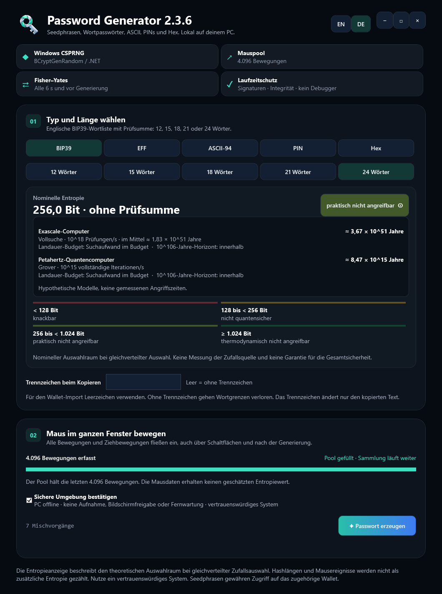
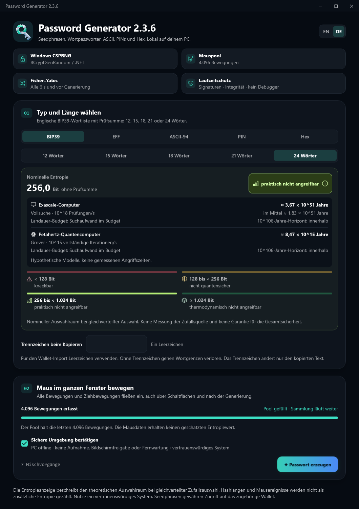

# Windows design correction: Password Generator 2.3.6

The Windows interface now follows the macOS layout in
`Sources/PasswordGeneratorApp/GeneratorView.swift` more closely. The supplied
artwork, dark palette, 30/28 outer padding, 22-point card padding, 23-point card
corners and typography hierarchy remain anchored to that source. Segoe UI
Variable supplies the Windows system font; this is a source-based adaptation,
not a measured pixel-identical rendering of an app running on macOS.

## Changes

- Mode, BIP39 word count, hex case and language use shared segmented tracks.
- Text boxes, checkbox, slider, progress indicator, disclosure and scrollbars
  use a consistent rounded theme with visible keyboard focus.
- Window controls occupy a separate compact caption bar, keeping the brand
  header aligned with the macOS composition.
- Security badges use small vector icons in tinted tiles. Cards use subtle
  shadows and the original spacing; secondary text uses a neutral tint.
- The entropy number is large while units and checksum annotation stay small.
  Rating chips use matching level colors; attack models have separate rows,
  aligned estimates and a divider. Long German labels can wrap.
- Status badges and the four-level legend adapt between two and four columns
  at the original logical-width thresholds.

## Visual evidence

Both images below were rendered offscreen with a separate public design fixture.
They contain no generated passwords, wallet seeds or signing material. Their
ready-pool/runtime status is simulated to show the layout and is not security
evidence. Full-page previews include content normally reached by scrolling.

Before:

After:

The development-only [preview harness](../Windows/PasswordGenerator.DesignPreview/README.md)
links the production visual tree and theme with its own fake model. It never
creates a native window, loads private keys or writes the clipboard. Layout
checks and manual image inspection complement the source comparison.

The final matrix passes all 120 scenes: five modes, English/German, three window
sizes and collecting/ready/concealed/revealed states. Checks cover text clipping,
horizontal overflow, rich-text font sizes and actual WPF control bindings and
routed commands. Additional renders pass for a 512-character hex result, an
invalid length and a 3840×2160 viewport. Public-fixture button checks exercise
BIP39 length selection, PIN slider increments, hex case and replacement of
old legend views. The [matrix summary](evidence/windows-2.3.6-design/matrix.json)
and [representative report](evidence/windows-2.3.6-design/representative-layout.json)
record these results; this fixture does not verify real password generation.

## Build, installation and security scope

The release builds without warnings. The corrected self-contained distribution
and installed copy each pass the exact 405-file/14-directory inventory check.
Both RSA-4096 and ML-DSA-87 signatures also pass independent OpenSSL verification;
the ZIP passes exact-content verification. The installed app's accessibility
tree reports a successful runtime gate and exposes the updated control names.
Artifact hashes and verification scope are recorded in
[verification.json](evidence/windows-2.3.6-design/verification.json).

The production model, entropy generation, clipboard ownership and security
implementations are unchanged. Source review checked that concealment and cleanup
hooks remain connected. The fixture harness is a separate executable and is not
included in the installed or signed app. Existing signing keys are reused from
`A:\Passoword Generator Keys`.

The offscreen render cannot verify native caption hit testing, maximize/taskbar
behavior or a screen reader session. Interactive caption automation was blocked
by the app's capture exclusion; that protection was retained. These checks do not
constitute a complete accessibility certification or a new independent security audit.
